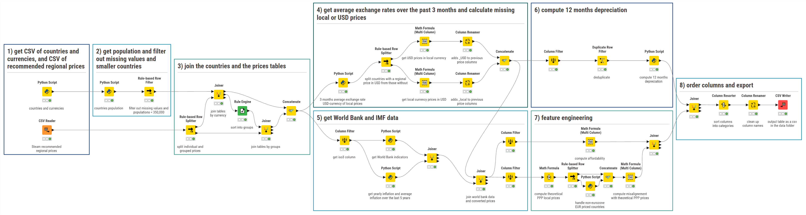
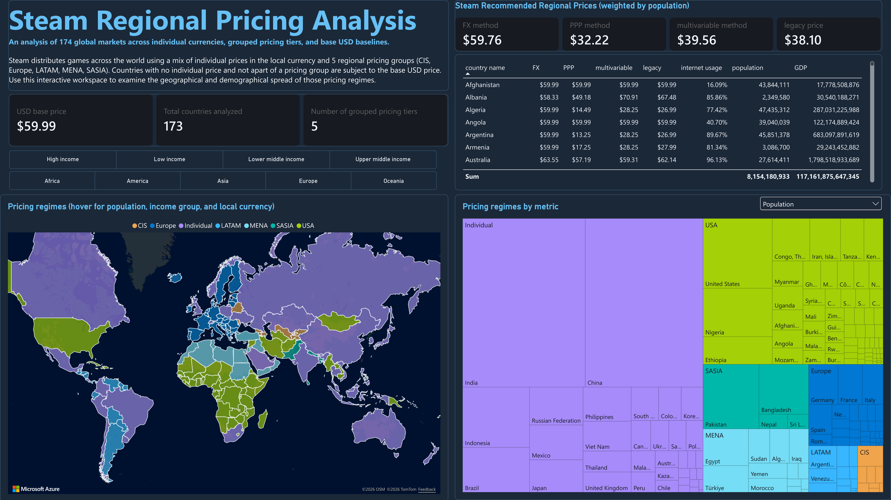
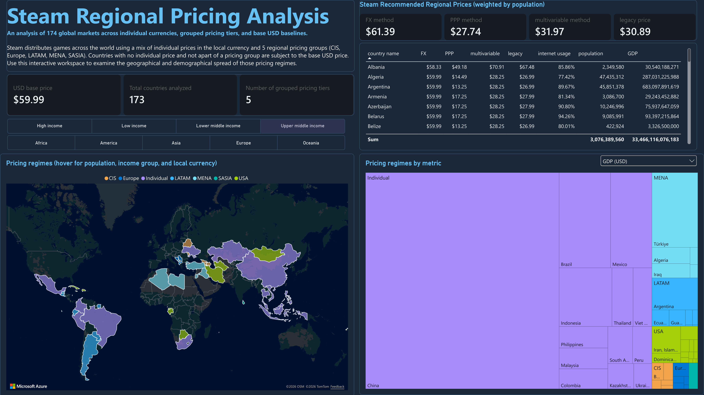
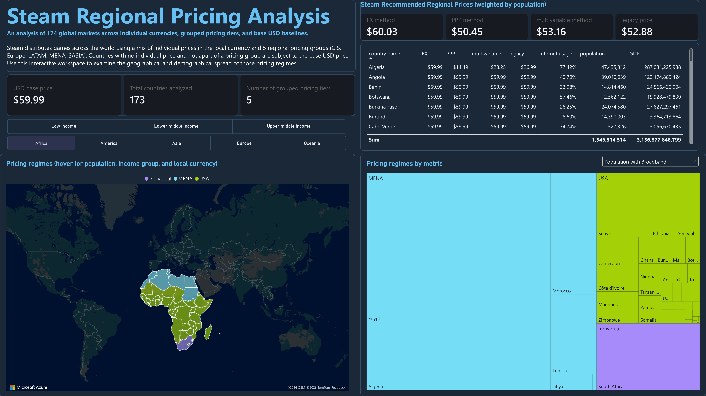
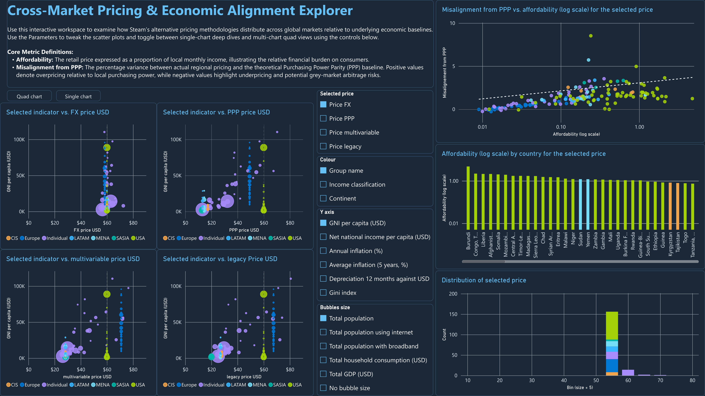
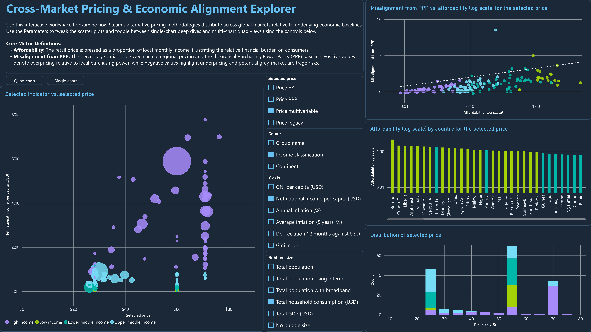
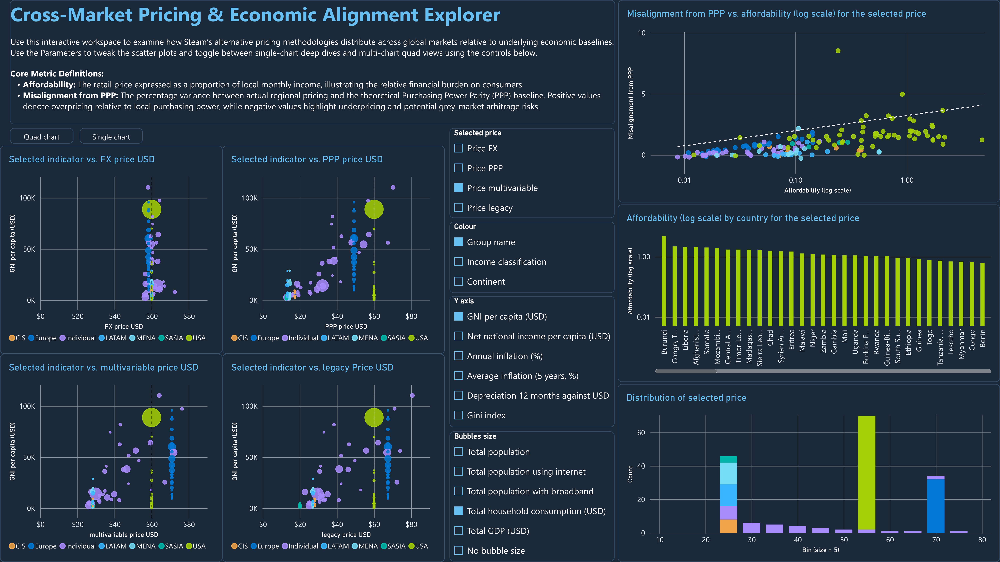
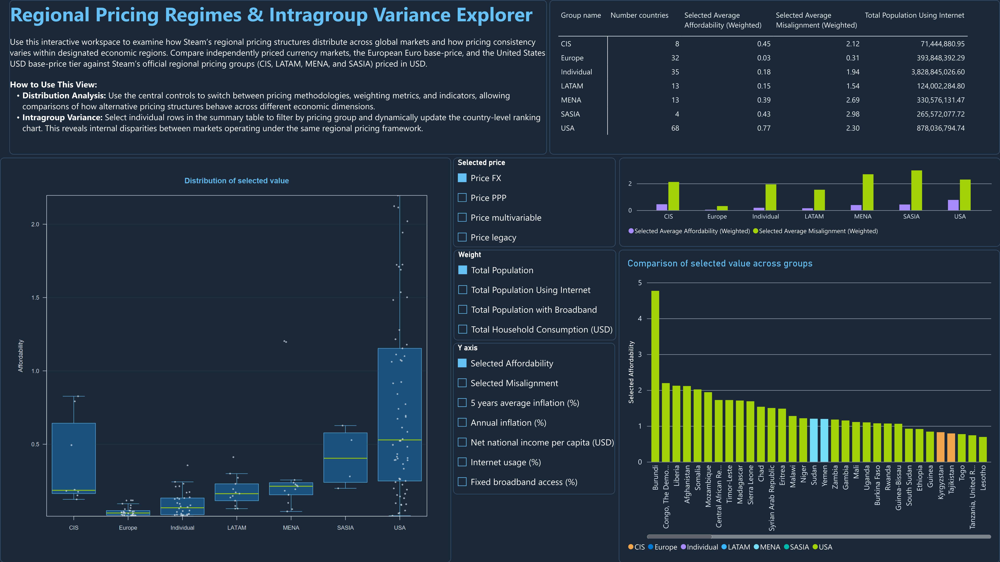
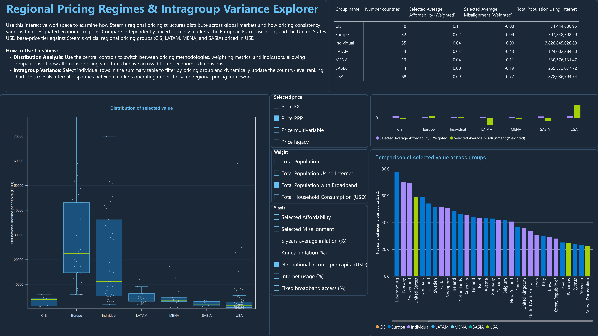
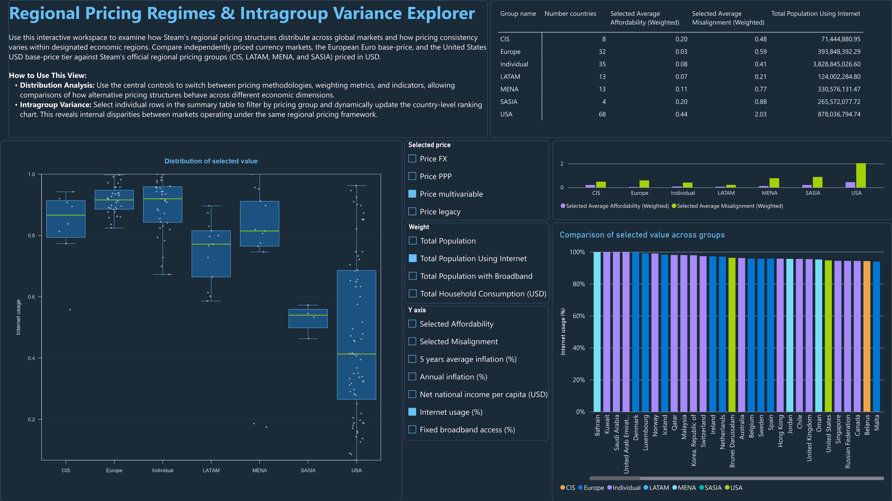

# Steam Regional Pricing: Global Economic Alignment & Methodological Evolution

An automated, end-to-end data engineering and economic analysis pipeline evaluating how the digital video game distribution platform **Steam** applies regional pricing across global markets relative to underlying economic realities.

This project evaluates pricing strategy across **four distinct pricing methodologies** for a standard 59.99 USD benchmark video game:
- **The Legacy Pricing (2022–2026):** Steam's long-standing regional pricing structure prior to recent updates.
- **FX-Based Pricing:** driven strictly by foreign exchange rates against the US Dollar.
- **PPP-Based Pricing:** driven by the Purchasing Power Parity rate.
- **Multivariable Pricing:** combines multiple macroeconomic factors.

Those methodologies are Steam's recommendation, and video game editors are free to set their own regional prices.

This project evolves a university research essay (Grade: 6.0 / 6, found in the legacy folder) into a reproducible data pipeline built with **KNIME**, **Python**, **R**, and visualized via interactive **PowerBI** and **Tableau** (in the future) dashboards.

---

## 📁 Repository Architecture
<pre>
📦 Steam-Regional-Pricing/\
├── 📁 data/                            # Raw inputs & final dataset (steam_regional_pricing_dataset.csv)
├── 📁 KNIME_steam_regional_pricing/    # KNIME workflow
├── 📁 python/                          # Python scripts embedded within KNIME nodes
├── 📁 dashboards/                      # PowerBI templates (.pbix) and Tableau workbook files
├── 📁 legacy/                          # Previous university R script and report
├── 📁 assets/                          # Images for documentation
└── 📄 README.md                        # Project overview, methodology, and data dictionary
</pre>

## ⚙️ Data Engineering Pipeline (KNIME & Scripts)

The pipeline is structured into 8 modular blocks inside KNIME, executing data ingestion, currency normalization, macroeconomic enrichment, and feature engineering automatically:

1. **Ingestion**: Imports raw country lists and Steam recommended prices via CSV readers and Python API wrappers.

2. **Filtering**: Gets population data from the World Bank API and filters out territories with a population under 350,000 alongside Taiwan, Palestine, and North Korea due to incomplete World Bank reporting.

3. **Joins**: Dynamically joins countries with individual and grouped regional prices.

4. **Currency Conversions**: Computes 90-day trailing average exchange rates to resolve missing local or USD price.

5. **Macroeconomic Enrichment**: Import World Bank (wbgapi) and IMF indicators.

6. **Depreciation**: Computes 12-month trailing local currency depreciation against the USD.

7. **Feature Engineering**: Calculates theoretical PPP prices, price-to-income affordability ratios, and percentage misalignments from PPP.

8. **Export**: Resorts, rename columns, and exports a CSV dataset.

## Power BI Interactive Dashboard

Due to custom R-script visual components (used for boxplots) and organization sharing permissions, static previews of the interactive Power BI report are showcased below across its three pages.

### Page 1: Global Overview of Pricing Regimes
Provides a macro-level overview of global market coverage, mapping the geographical and demographic distribution of Steam’s pricing regimes (Individual currencies vs. Regional Pricing Groups) alongside population-weighted dynamic average regional price and drill-down country tables.

### Page 2: Cross-Market Pricing & Economic Alignment Explorer
Evaluates how alternative pricing structures behave relative to macroeconomic baselines (GNI per capita, net income, inflation, inequality). Features dynamic parameter switching between a single-chart deep dive and a 2x2 quad-chart matrix comparing all four pricing methods simultaneously, alongside ranked affordability rankings and price distribution histograms.

### Page 3: Regional Pricing Regimes & Intragroup Variance Explorer
Investigates the economic efficiency of Uniform Regional Pricing Groups (LATAM, MENA, CIS, SASIA) compared against tailored Individual Currency Markets and the two base-price tiers. Utilizes custom R-scripted boxplots to analyze intra-group variance, median spreads, and outlier distributions across customizable economic and weighting dimensions.

## Tableau Narrative Dashboard
Will present the insights from the interactive Power BI dashboard (WIP)

## steam_regional_pricing_dataset.csv 

### Overview & Scope
The dataset contains **173 entries** covering global markets. Micro-states and territories with a population under 350,000 have been excluded to eliminate map rendering clutter and meaningless noise. Taiwan, Palestine and North Korea have been excluded due to a lack of World Bank data.

---

### Column Definitions

##### Country Identifiers
- `country_name` : Standardized name of the country `(Source: pycountry)`
- `iso2` : ISO 3166-1 alpha-2 two-letter country code `(Source: pycountry)`
- `iso3` : ISO 3166-1 alpha-3 three-letter country code `(Source: pycountry)`

##### Groupings
- `continent` : Predominant continent of the country `(Source: country_converter)`
- `group` : Boolean flag (`True` if the country shares a regional pricing tier with others, `False` for individual pricing)
- `group_name` : Pricing category tier (`CIS`, `Europe`, `LATAM`, `SASIA`, `USA` as base, or `Individual`)
- `WB_income_classification` : World Bank income tier (`Low income`, `Lower middle income`, `Upper middle income`, `High income`) `(Source: wbgapi)`

##### Currencies and Exchange Rates
- `currency_code_country` : ISO 4217 currency code of the country's domestic legal tender `(Source: babel)`
- `currency_code_steam_price` : Currency code used by Steam to quote prices in that market (may match domestic currency or default to USD/EUR)
- `currency_name_steam_price` : Full display name of the Steam pricing currency
- `exchange_rate_USD_currency_regional_price` : 3-month trailing average exchange rate between USD and the Steam pricing currency `(Source: frankfurter API)`
- `PPP_rate_households` : World Bank household final consumption purchasing power parity conversion factor `(Source: wbgapi)`
- `theoretical_PPP_price_local` : Theoretical local price baseline adjusted for purchasing power parity
- `FX_Depreciation_12_months_USD` : 12-month trailing depreciation rate of the local currency against the USD `(Source: frankfurter API)`
- `IMF_inflation_yearly` : Current year annual inflation rate `(Source: IMF)`
- `IMF_inflation_5_years_average` : 5-year historical average inflation rate `(Source: IMF)`

##### World Bank Data
- `total_population` : Total resident population count `(Source: wbgapi)`
- `WB_gdp_usd` : Gross Domestic Product in current USD `(Source: wbgapi)`
- `WB_households_final_consumption_expenditure` : Total household final consumption expenditure (USD) `(Source: wbgapi)`
- `WB_gini_index` : World Bank Gini index measuring income inequality (scale 0 to 100) `(Source: wbgapi)`
- `WB_net_national_income_per_capita` : Net national income per capita in USD `(Source: wbgapi)`
- `WB_gni_per_capita` : Gross National Income per capita (Atlas method, USD) `(Source: wbgapi)`
- `WB_percent_using_internet` : Proportion of individuals who used the Internet in the last three months (acting as a proxy for the addressable PC gaming market size) `(Source: wbgapi)`
- `WB_fixed_broadband_subscriptions_per_100` : Fixed broadband subscriptions per 100 inhabitants (acting as a proxy for the addressable PC gaming market size) `(Source: wbgapi)`

##### Steam Recommended Regional Prices
- `price_steam_FX_USD` : Steam's FX-based recommended price in USD
- `price_steam_PPP_USD` : Steam's PPP-based recommended price in USD
- `price_steam_multivariable_USD` : Steam's multivariable-based recommended price in USD
- `price_steam_legacy_USD` : Steam's legacy (2022–2026) recommended price in USD
- `price_steam_FX_local` : Steam's FX-based recommended price quoted in the Steam pricing currency
- `price_steam_PPP_local` : Steam's PPP-based recommended price quoted in the Steam pricing currency
- `price_steam_multivariable_local` : Steam's multivariable-based recommended price quoted in the Steam pricing currency
- `price_steam_legacy_local` : Steam's legacy recommended price quoted in the Steam pricing currency

##### Derived Business Metrics 
- `affordability_price_steam_FX` : Game price expressed as a ratio of the monthly net national income per capita
- `affordability_price_steam_PPP` : Affordability ratio for the PPP-based pricing method
- `affordability_price_steam_multivariable` : Affordability ratio for the multivariable pricing method
- `affordability_price_steam_legacy` : Affordability ratio for the legacy pricing method
- `misalignment_from_PPP_price_steam_FX` : Percentage variance between the actual Steam FX price and the theoretical PPP price (`(Actual - Theoretical) / Theoretical`)
- `misalignment_from_PPP_price_steam_PPP` : Percentage variance for the Steam PPP price method
- `misalignment_from_PPP_price_steam_multivariable` : Percentage variance for the multivariable price method
- `misalignment_from_PPP_price_steam_legacy` : Percentage variance for the legacy price method